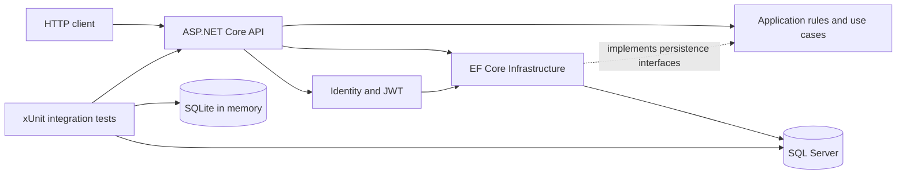

# CommerceOps API

[](https://github.com/Damilleo/commerceops-api/actions/workflows/ci.yml)

CommerceOps models a small warehouse. A catalog administrator maintains products, a warehouse operator receives or issues stock, and a reviewer can check the available quantity and movement history.

- **Catalog** manages categories and products with unique SKUs and paginated queries.
- **Inventory** records receipts and issues in an append-only history and prevents concurrent requests from overspending stock.
- **Access control** uses ASP.NET Core Identity and short-lived JWTs for Admin, Operator, and Viewer permissions.
- **Stack** uses .NET 10, ASP.NET Core Minimal APIs, EF Core, SQL Server, OpenAPI, xUnit, and GitHub Actions.

## Quick start

Allow about five minutes after installing the [.NET SDK](global.json), PowerShell 7.2+ or Bash, and Docker with Compose v2. The first SQL Server image download may take longer.

1. Follow the [Windows PowerShell or Bash setup](docs/local-setup.md) to generate local configuration and wait for SQL Server to be healthy.
2. Run the EF migration and `seed-demo` commands in the guide, then start the API. The seed adds two categories and three fictitious products. Run the separate admin bootstrap to try authenticated writes.
3. Open the [HTTP request collection](requests/commerceops.http) or follow the [smoke test](docs/api-examples.md). Start with `GET http://localhost:5080/health` and `GET /api/v1/products`. The Development OpenAPI document is at `/openapi/v1.json`.

## Architecture



| Path | Responsibility |
| --- | --- |
| `src/CommerceOps.Api` | HTTP contracts, OpenAPI, authorization, and local commands |
| `src/CommerceOps.Application` | Catalog validation and inventory business rules |
| `src/CommerceOps.Infrastructure` | EF Core SQL Server persistence, migrations, and demo data |
| `tests/CommerceOps.Api.Tests` | Unit tests and HTTP, database, and migration tests |

Inventory uses a conditional SQL update to check and change the balance in one statement. The balance update and movement insert commit in the same transaction. If two operators issue the last unit at the same time, one succeeds and the other gets 409. Database constraints prevent negative balances, duplicate SKUs, and deletion of products with movement history. See the [architecture notes](docs/architecture.md).

## Build and test

```sh
dotnet restore CommerceOps.slnx
dotnet build CommerceOps.slnx -c Release --no-restore
dotnet test CommerceOps.slnx -c Release --no-build
```

CI runs the fast suite with relational SQLite and reruns it with SQL Server for migrations, constraints, and concurrent inventory writes. It also migrates and seeds a separate database, starts the API, and verifies anonymous reads and admin sign-in using the Compose service.

## Security and limits

Use fictitious, non-sensitive data in a local development environment. Catalog and inventory GET routes are anonymous. Writes require a bearer token and the appropriate role. The demo issues 15-minute JWTs and provides no public registration, password reset, refresh, or revocation. Keep local secrets out of source control and diagnostic output. This project is not intended for public production deployment with real data. See the [security and role details](docs/architecture.md#authentication-and-permissions).
